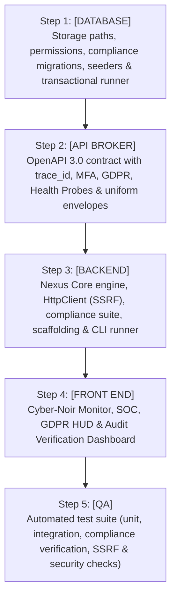

# Dreambox Nexus: Custom Security-First PHP Framework Blueprint

> **Status:** Approved Architectural Blueprint (v7.0 - Enterprise Battle-Ready & Zero-Blindspot Architecture)  
> **Framework Name:** Nexus Core  
> **Core Mandate:** 100% Custom PHP Framework (Zero external framework dependencies, strictly NOT Fat-Free). Ultra-lightweight, robust, secure by default, and engineered to satisfy regulatory compliance standards: **PCI-DSS v4.0**, **HIPAA Security Rule**, **NIST CSF 2.0**, and **EU GDPR**.  
> **Target Environment:** WSL2 Ubuntu, PHP 8.5+, Windows Dev Drive (`/mnt/d/Projects/Dreambox Nexus`), served via Nginx/PHP-FPM at `http://localhost`.

---

## 1. Regulatory Compliance Mapping & Control Invariants

Nexus Core is architected to satisfy four major global compliance standards out of the box:

| Framework | Core Requirement | Framework Architectural Implementation |
| :--- | :--- | :--- |
| **PCI-DSS v4.0** | Req 3: Protect Stored Account Data | `Crypto.php` (AES-256-GCM AEAD), `KeyManager.php` (Envelope encryption & DEK rotation), `DataMasker.php` (PAN truncation to first-6/last-4). |
| **PCI-DSS v4.0** | Req 8: Identification & Authentication | `Mfa.php` (Native RFC 6238 TOTP), `AccountLockout.php` (Lockout after 5 failed attempts for 30 min), `Hasher.php` (Argon2id). |
| **PCI-DSS v4.0** | Req 10: Log & Monitor All Access | `AuditLogger.php` with Cryptographic Hash-Chaining (tamper-evident audit trail), automated `trace_id` injection, and time-stamped actors. |
| **HIPAA Security** | 164.312(a)(1) Access Control | Session Inactivity Timeout (15-min idle disconnect), Absolute Session Expiration, and granular RBAC via `Gate.php`. |
| **HIPAA Security** | 164.312(b) Audit Controls | Append-only database audit log capturing all reads, mutations, and exports of ePHI records. |
| **HIPAA Security** | 164.312(c)(1) Integrity | Cryptographic HMAC validation on all sensitive data fields and database audit log entries. |
| **HIPAA Security** | 164.312(e)(1) Transmission | Strict HSTS enforcement, TLS 1.3/1.2 requirement, and complete masking of ePHI in application logs. |
| **NIST CSF 2.0** | **PR.AA** (Identity & Access Control) | Multi-factor authentication (TOTP), least-privilege RBAC, and automated session invalidation upon privilege modification. |
| **NIST CSF 2.0** | **PR.DS** (Data Security) | Transparent field-level encryption for PII/ePHI, secure data disposal (cryptographic shredding & soft deletes). |
| **NIST CSF 2.0** | **DE.CM** & **DE.AE** (Detect & Analyze) | `AnomalyDetector.php` in monitor engine detecting anomalous traffic spikes, brute-force attempts, and rapid credential spraying. |
| **NIST CSF 2.0** | **RS.MA** (Incident Response) | Automatic rate-limiting circuit breakers, IP blackholing, and one-click session revocation from the Monitor Dashboard. |
| **GDPR** | **Art 7** (Conditions for Consent) | `ConsentManager.php`: Timestamped, versioned, purpose-specific consent recording and one-click withdrawal mechanism. |
| **GDPR** | **Art 15 & 20** (Access & Portability) | `GdprManager.php`: Automated JSON/CSV data export packaging all personal data across all relations for the requesting user. |
| **GDPR** | **Art 17** (Right to Erasure / Shredding) | `GdprManager.php` & `DataAnonymizer.php`: Cascading data purging and cryptographic shredding of PII while preserving anonymized audit hashes. |
| **GDPR** | **Art 25** (Privacy by Design / Default) | Strict-by-default session cookies, zero tracking before consent, and automatic field-level encryption for personal identifiers. |
| **GDPR** | **Art 33** (72-Hour Breach Notification) | `AnomalyDetector.php` automated incident tagging and breach notification dispatch pipeline. |

---

## 2. Mandatory Threat Modeling & Security Invariants

| Subsystem | Threat Vector | Mandatory Defensive Invariant |
| :--- | :--- | :--- |
| **Autoloader** | LFI / Path Traversal | Must validate namespace prefix `Nexus\`, enforce regex `/^[a-zA-Z0-9_\\]+$/`, and assert `realpath()` stays within `src/`. |
| **CLI Runner** | Web SAPI Trigger | Must verify `PHP_SAPI === 'cli'`; reject HTTP execution immediately with HTTP 403. |
| **Ingress IP** | Rate-Limit Evasion | Never trust `X-Forwarded-For` unless `REMOTE_ADDR` matches an explicit trusted proxy whitelist (e.g., `127.0.0.1`, `::1`). |
| **Outbound HTTP** | SSRF / Cloud Metadata Theft | `HttpClient.php` automatically blocks private/internal IPs (`10.0.0.0/8`, `172.16.0.0/12`, `192.168.0.0/16`, `127.0.0.0/8`, `169.254.169.254`). |
| **CORS** | Credential Leakage | Exact whitelist matching or anchored regex; never allow wildcard `*` when `Allow-Credentials: true`. |
| **CSP** | XSS / Clickjacking | Dynamic per-request CSP nonce (`base64_encode(random_bytes(16))`); enforce `frame-ancestors 'none'`, `object-src 'none'`, `base-uri 'self'`. Ingest violations via `/api/v1/security/csp-reports`. |
| **Rate Limiter** | Concurrency Race Condition | Use atomic DB operations (`INSERT ... ON DUPLICATE KEY UPDATE`) or file-based `flock(..., LOCK_EX)`. |
| **Error Handling** | Information Disclosure | Redact sensitive keywords (`password`, `key`, `secret`, `dsn`, `token`, `authorization`, `pan`, `ssn`) from traces; mask all internals in production. |
| **Session** | Fixation & Local Hijack | Call `session_regenerate_id(true)` upon privilege change; enforce `storage/sessions/` directory permissions at `0700`. Enforce 15-minute idle timeout. |
| **Database** | Dynamic SQL Injection | Parameterized queries for values; strict static whitelist verification for dynamic identifiers (tables, columns, order). |
| **Database** | Multi-byte Truncation | Force `charset=utf8mb4` with collation `utf8mb4_unicode_ci` on all PDO connections. |
| **Crypto / AEAD** | Padding Oracle / Bit-Flipping | AES-256-GCM authenticated encryption; mandatory MAC authentication tag verification before payload decryption. |
| **Auth / Passwords** | Hash Extraction & Collision | Enforce `PASSWORD_ARGON2ID`; dynamic rehashing via `password_needs_rehash()`; API tokens stored as salted `SHA-256` hashes. |
| **MFA Subsystem** | Credential Stuffing & Replay | Native RFC 6238 TOTP with single-use replay suppression within the 30-second window. |
| **Audit Log** | Log Tampering / Repudiation | Cryptographic Hash-Chaining: each log entry contains `hash('sha256', prev_hash . entry_data)`. Any DB alteration breaks the chain. |
| **GDPR Erasure** | Residual PII Leakage | Right to be Forgotten execution must overwrite PII with irreversible cryptographic salts (`DataAnonymizer.php`) or delete rows completely. |
| **Consent Engine** | Non-Compliant Cookie Dropping | Zero tracking cookies or third-party analytical telemetry can be dispatched before positive affirmative consent is logged. |
| **Data Masking** | PII / PAN / ePHI Bleed | Strict automated masking in logs, displays, and API outputs (`DataMasker.php`). |
| **Model Layer** | Mass-Assignment / Tampering | Strict `$fillable` attribute whitelisting on all entities; reject unlisted attributes on insert/update. |
| **File Storage** | Remote Code Execution | Verify binary magic bytes via `finfo_file()`; generate UUID filenames; store strictly outside web root; neutralize SVG files. |
| **Queue Worker** | Worker Crash / Job Poisoning | Maximum retry limits, exponential backoff, dead-letter `failed_jobs` table, and `SKIP LOCKED` concurrency locks. |
| **Mailer** | Header Injection (CRLF) | Regex sanitize all `To:`, `Cc:`, and `Subject:` headers against `\r` and `\n` to prevent relay hijacking. |
| **Monitor Dashboard** | Telemetry Data Exfiltration | Protected by dedicated `Gate::authorize('view-monitor')` or dev-environment guard; automated secret-redaction on all state inspection. |

---

## 3. Architectural Pillars

### A. Core Engine (`src/Core/`)
* **`Autoloader.php`**: Zero-dependency native PSR-4 autoloader with strict path sanitization.
* **`Env.php`**: Zero-dependency `.env` parser handling type casting, quotes, comments, and immutability.
* **`ErrorHandler.php`**: Global error/exception interceptor with credential scrubbing and uniform envelope emission.
* **`Logger.php`**: Structured JSON/text file logger with severity levels, `flock` thread-safety, and `trace_id` injection.
* **`MiddlewareInterface.php`**: Pipeline contract: `handle(Request $request, callable $next): Response`.
* **`App.php`**: Micro-kernel managing bootstrap, environment detection, and request-response lifecycle.
* **`Router.php`**: Fast regex-compiled router supporting parameterized route patterns, route groups, prefixes, and middleware stacks.
* **`Request.php`**: Immutable, sanitized HTTP request representation with automated UUIDv4 `trace_id`, trusted proxy resolution, and safe JSON parsing.
* **`Response.php`**: Standardized response emitter enforcing HTTP status codes, security headers, and the standard JSON envelope.
* **`HttpClient.php`**: Hardened native cURL client with built-in SSRF protection (blocking internal private ranges and cloud metadata endpoints), TLS 1.2/1.3 enforcement, and timeout resilience.
* **`Translator.php`**: Zero-dependency multilingual localization (i18n) engine with fallback resolution and parameterized string interpolation (`lang/` catalogs).
* **`HealthCheck.php`**: Production health probes: `GET /health` (ultra-fast liveness probe) and `GET /health/ready` (readiness probe verifying MariaDB, storage writeability, and queue heartbeat).
* **`Container.php`**: Zero-overhead lightweight dependency injection container / service locator.

### B. Cryptography & Key Management (`src/Crypto/`)
* **`Crypto.php`**: Authenticated Encryption with Associated Data (AEAD) using `AES-256-GCM`. Protects cardholder data (PCI), ePHI (HIPAA), and personal data (GDPR) at rest.
* **`KeyManager.php`**: Enterprise key management supporting Master Keys, Data Encryption Keys (DEKs), key derivation (`hash_hkdf`), and DEK rotation without full database re-encryption.
* **`Hasher.php`**: Hardened password hashing using `Argon2id` with automated cost migration via `password_needs_rehash()`.

### C. Identity, Authentication & Access Control (`src/Auth/`)
* **`Auth.php`**: Dual-guard authentication manager (Session Guard for Web UI, Bearer Token Guard for APIs).
* **`Mfa.php`**: Zero-dependency RFC 6238 Time-based One-Time Password (TOTP) engine compatible with Google Authenticator, YubiKey Authenticator, and 1Password. Includes single-use Argon2id recovery codes.
* **`AccountLockout.php`**: PCI-DSS Req 8.3.4 compliant lockout engine: locks accounts after 5 consecutive failed login attempts for a 30-minute cooling period.
* **`Gate.php`**: Granular Role-Based Access Control (RBAC) and resource-level policies to eliminate Insecure Direct Object References (IDOR).

### D. Compliance, GDPR & Privacy Subsystems (`src/Compliance/` & `src/Security/`)
* **`ComplianceVerifier.php`**: Automated 10-point compliance verification engine executed via `php bin/nexus compliance:verify` to audit cryptographic health, file permissions, and security headers.
* **`GdprManager.php`**:
  * **Right to Data Portability (Art 20):** Packages all user records, activity history, and profiles into a structured JSON/CSV archive.
  * **Right to Erasure / Forgotten (Art 17):** Cascading deletion of personal data and automated cryptographic shredding.
  * **Data Subject Request (DSR) Tracking:** Manages pending, in-progress, and fulfilled GDPR requests with SLA tracking (30-day mandate).
* **`ConsentManager.php`**:
  * Granular consent capture: logs timestamp, user ID, purpose (Essential, Analytics, Marketing), version, and IP.
  * Provides zero-friction withdrawal of consent and consent verification gates.
* **`DataAnonymizer.php`**:
  * Replaces identifiable PII with irreversible salted SHA-256 hashes or synthetic placeholders (pseudonymization) to satisfy regulatory data retention requirements (e.g., tax/accounting laws) without retaining personal identities.
* **`DataMasker.php`**: Automated masking of sensitive data (PAN truncation to first-6/last-4, SSN/ePHI redaction) across logs, views, and debugging inspectors.
* **`Headers.php`**: Defense-in-depth headers, HSTS, dynamic per-request CSP nonce generator, and CSP report URI mapping.
* **`Cors.php`**: Strict whitelist-based CORS preflight and origin verification.
* **`Csrf.php`**: Cryptographically secure timing-safe HMAC tokens (`hash_equals`) bound to user sessions.
* **`RateLimiter.php`**: Race-condition-free sliding-window rate limiter with trusted proxy IP validation.
* **`Sanitizer.php`**: Recursive input sanitizer and XSS attack mitigation.
* **`Validator.php`**: Schema validation engine supporting standard rules emitting structured `422` error envelopes.
* **`Session.php`**: Secure session engine enforcing `SameSite=Strict`, `HttpOnly`, `Secure`, 15-minute idle timeout (HIPAA), and session fixation regeneration.

### E. Hardened Data Layer & Model Engine (`src/Database/`)
* **`Database.php`**: Hardened PDO wrapper with `utf8mb4` charset, prepared statements, and dynamic identifier whitelisting.
* **`QueryBuilder.php`**: Fluent, zero-dependency SQL query builder guaranteeing 100% parameterization.
* **`Model.php`**: Lightweight active entity model featuring:
  * Mass-assignment protection (`$fillable` / `$guarded`)
  * Transparent attribute casting (JSON, dates, encrypted fields via `Crypto.php`)
  * Soft deletes (`deleted_at`) for accidental deletion protection
  * Automatic GDPR anonymization hooks (`anonymize()`)
  * Timestamps (`created_at`, `updated_at`)
* **`MigrationRunner.php`**: Transactional, atomic schema migration engine.
* **`Seeder.php`**: Repeatable database seeder supporting environment-specific initialization and administrative account bootstrapping.
* **`Factory.php`**: Model factory engine for generating consistent, typed mock data for testing.

### F. Asynchronous Queue & Background Worker (`src/Queue/`)
* **`Queue.php`**: MariaDB database queue driver utilizing `SELECT ... FOR UPDATE SKIP LOCKED` for collision-free concurrent worker execution.
* **`Worker.php`**: CLI background worker process (`php bin/nexus queue:work`) with retry limits, exponential backoff, job timeouts, and dead-letter queue routing (`failed_jobs` table).

### G. Event Bus & Cryptographic Compliance Audit Trail (`src/Events/`)
* **`EventDispatcher.php`**: Decoupled Publish-Subscribe event bus allowing asynchronous and synchronous listeners.
* **`AuditLogger.php`**: Immutable, append-only security audit log using **Cryptographic Hash-Chaining**:
  * Each log entry calculates `sha256(prev_hash + user_id + action + resource + payload_diff + trace_id + timestamp)`.
  * Guarantees tamper-evidence: any unauthorized row modification, deletion, or insertion breaks the chain and triggers an instant alert.
  * Satisfies PCI-DSS Req 10, HIPAA §164.312(b), and GDPR Art 30.

### H. File Storage & Upload Pipeline (`src/Storage/`)
* **`Storage.php`**: Filesystem abstraction separating private storage (`storage/app/private/`) from public assets.
* **`FileUploader.php`**: Hardened upload validator with binary MIME-type sniffing (`finfo_file`), UUID filename randomization, and SVG sanitization.

### I. Cache & Distributed Locking (`src/Cache/`)
* **`Cache.php`**: Multi-driver caching (MariaDB / File) with TTL expiration and cache tagging.
* **`Lock.php`**: Atomic distributed mutex locks to prevent race conditions during concurrent critical operations.

### J. Centralized Task Scheduler & Retention Engine (`src/Schedule/`)
* **`Scheduler.php`**: Single-cron orchestration engine (`php bin/nexus schedule:run`) managing recurring tasks:
  * Automatic session pruning and token expiration.
  * Audit log archival and retention enforcement (PCI 1-year / HIPAA 6-year retention policies).
  * GDPR data retention purges (automatic disposal of data past legal retention deadlines).
  * Worker heartbeat checks and cache cleanup.

### K. Transactional Mailer (`src/Mail/`)
* **`Mailer.php`**: Pure PHP SMTP client supporting TLS/STARTTLS with strict CRLF injection defense and async queue delivery.

### L. View & Templating Subsystem (`src/View/`)
* **`View.php`**: Lightweight server-side template engine with template inheritance, auto-escaping (`htmlspecialchars`), and automatic CSP nonce binding.

### M. Comprehensive Observability & Gated Cockpit (`src/Monitor/` & `resources/views/monitor/`)
A native, zero-external-dependency, cyber-noir glassmorphic administrative HUD providing 360-degree real-time telemetry across the entire framework. Strictly isolated from the public document root and gated behind `MonitorAccessMiddleware` (RBAC `view-telemetry` & IP allowlist) at `GET /nexus/monitor` to prevent unauthenticated information disclosure:

* **`SystemProfiler.php`**: CPU, memory (current/peak/limit), disk space, and Zend OPcache statistics.
* **`HttpProfiler.php`**: Real-time RPS, latency distribution, HTTP status codes, and searchable `trace_id` request explorer.
* **`SecurityMonitor.php`**: Active throttled client IPs, CSRF mismatches, failed logins, CSP reports, and account lockout events.
* **`CspReporter.php`**: Dedicated ingestion controller for `/api/v1/security/csp-reports`.
* **`AnomalyDetector.php`**: NIST CSF anomaly detection engine tracking credential spraying, bulk data export attempts, and rate-limit violations.
* **`GdprMonitor.php`**: Active consent breakdown (Granted vs Revoked), pending Data Subject Requests (Export / Erase) with one-click fulfillment, and privacy compliance health.
* **`DatabaseProfiler.php`**: Active connections, slow query detection (>50ms), and migration execution state.
* **`QueueMonitor.php`**: Queue depth gauges (pending/reserved/completed), worker heartbeats, and failed jobs retry manager.
* **`SchedulerMonitor.php`**: Cron timeline, execution history, and countdowns.
* **`CacheMonitor.php`**: Cache hit/miss ratio, active keys, distributed locks, and one-click purge.
* **`AuditExplorer.php`**: Filterable live audit log with JSON diff viewer and **Cryptographic Hash-Chain Verification Indicator** (Green = Verified Untampered).
* **`RouteRegistry.php`**: Live searchable route table with verb filtering and active middleware stacks.

### N. Developer CLI Tooling & Scaffolding (`src/Console/`)
* **`ConsoleKernel.php`**: Command dispatcher for terminal execution.
* **Code Scaffolding Generators (`src/Console/Generators/`)**:
  * `php bin/nexus make:controller <Name>`
  * `php bin/nexus make:model <Name>`
  * `php bin/nexus make:migration <Name>`
  * `php bin/nexus make:middleware <Name>`
  * `php bin/nexus make:seeder <Name>`

---

## 4. Directory Layout

```text
Dreambox Nexus/
├── BLUEPRINT.md                 # Persistent architectural blueprint (v7.0)
├── FRAMEWORK_GUIDE.md           # Comprehensive plain-English user manual & operations guide
├── bin/
│   └── nexus                    # CLI Runner (strictly PHP_SAPI === 'cli')
├── public/
│   └── index.php                # Unified HTTP Front Controller (Zero static bypass files)
├── resources/
│   └── views/
│       ├── welcome.php          # Public Application Gateway (Zero telemetry leakage)
│       └── monitor/
│           └── dashboard.php    # Gated Cyber-Noir Cockpit (Admin / SecOps only)
├── src/
│   ├── Core/
│   │   ├── App.php              # Micro-kernel
│   │   ├── Autoloader.php       # Native PSR-4 Autoloader with path sanitization
│   │   ├── Container.php        # Service Container
│   │   ├── Env.php              # Zero-dependency .env parser
│   │   ├── ErrorHandler.php     # Global Exception & Shutdown Handler (credential scrubbing)
│   │   ├── HealthCheck.php      # Liveness (/health) and Readiness (/health/ready) probes
│   │   ├── HttpClient.php       # Hardened outbound cURL client with SSRF protection
│   │   ├── Logger.php           # Structured file logger with flock
│   │   ├── MiddlewareInterface.php # Pipeline interface
│   │   ├── Request.php          # Immutable HTTP Request with trace_id & proxy validation
│   │   ├── Response.php         # Standardized JSON response emitter
│   │   ├── Router.php           # Regex route compiler & dispatcher
│   │   └── Translator.php       # Multilingual localization (i18n) dictionary engine
│   ├── Security/
│   │   ├── Cors.php             # Strict whitelist CORS & preflight
│   │   ├── Csrf.php             # Timing-safe HMAC token validator
│   │   ├── DataMasker.php       # PII, PAN (first-6/last-4), and ePHI masking engine
│   │   ├── Headers.php          # Defense-in-depth headers & dynamic CSP nonce
│   │   ├── RateLimiter.php      # Race-condition-free sliding-window rate limiter
│   │   ├── Sanitizer.php        # Input sanitizer
│   │   ├── Session.php          # Hardened session manager (15-min idle timeout & fixation defense)
│   │   └── Validator.php        # Schema validation engine (422 envelope)
│   ├── Compliance/
│   │   ├── ComplianceVerifier.php # 10-point automated compliance verification engine
│   │   ├── ConsentManager.php   # GDPR Art 7 consent tracking & withdrawal
│   │   ├── DataAnonymizer.php   # Cryptographic pseudonymization & PII scrubbing
│   │   └── GdprManager.php      # Art 17 Right to Erasure & Art 20 Data Portability engine
│   ├── Crypto/
│   │   ├── Crypto.php           # AES-256-GCM AEAD authenticated encryption
│   │   ├── KeyManager.php       # Master key & DEK envelope encryption & key rotation
│   │   └── Hasher.php           # Argon2id password hasher & rehash checks
│   ├── Auth/
│   │   ├── AccountLockout.php   # PCI Req 8.3.4 lockout engine (5 attempts / 30 mins)
│   │   ├── Auth.php             # Session & Bearer token authentication manager
│   │   ├── Gate.php             # RBAC & policy authorization engine
│   │   └── Mfa.php              # Native RFC 6238 TOTP Multi-Factor Authentication
│   ├── Database/
│   │   ├── Database.php         # Hardened PDO abstraction (utf8mb4 & identifier whitelist)
│   │   ├── Factory.php          # Model factory for test data generation
│   │   ├── MigrationRunner.php  # Transactional migration engine
│   │   ├── Model.php            # Active entity model (mass-assignment safe, casting, soft deletes, anonymization)
│   │   ├── QueryBuilder.php     # Fluent zero-dependency SQL query builder
│   │   └── Seeder.php           # Database seeder base class
│   ├── Queue/
│   │   ├── Queue.php            # MariaDB SKIP LOCKED queue driver
│   │   └── Worker.php           # CLI queue worker process & dead-letter handler
│   ├── Events/
│   │   ├── EventDispatcher.php  # Pub/Sub event bus
│   │   └── AuditLogger.php      # Tamper-evident cryptographic hash-chained audit log
│   ├── Storage/
│   │   ├── Storage.php          # Filesystem storage manager (private vs public)
│   │   └── FileUploader.php     # MIME-inspected, UUID-isolated upload pipeline
│   ├── Cache/
│   │   ├── Cache.php            # TTL cache store
│   │   └── Lock.php             # Atomic distributed mutex lock
│   ├── Schedule/
│   │   └── Scheduler.php        # Single-cron task scheduler & compliance retention manager
│   ├── Mail/
│   │   └── Mailer.php           # SMTP client with CRLF injection defense
│   ├── View/
│   │   └── View.php             # Server-side template engine with auto-escaping & CSP nonces
│   ├── Monitor/
│   │   ├── AnomalyDetector.php  # NIST CSF anomaly detection & alert engine
│   │   ├── AuditExplorer.php    # Audit trail data provider & hash-chain integrity verifier
│   │   ├── CacheMonitor.php     # Cache statistics collector
│   │   ├── CspReporter.php      # Browser CSP violation report collector
│   │   ├── DatabaseProfiler.php # Query timing & connection monitor
│   │   ├── GdprMonitor.php      # Consent metrics & Data Subject Requests manager
│   │   ├── HttpProfiler.php     # Latency & traffic metrics collector
│   │   ├── MonitorController.php# Authenticated JSON telemetry endpoints
│   │   ├── QueueMonitor.php     # Queue depth & failed jobs manager
│   │   ├── RouteRegistry.php    # Route inspection & middleware mapper
│   │   ├── SchedulerMonitor.php # Cron execution tracker
│   │   ├── SecurityMonitor.php  # Rate-limit, CSRF, and CSP alert collector
│   │   └── SystemProfiler.php   # CPU, Memory, OPcache & Disk metrics collector
│   └── Console/
│       ├── ConsoleKernel.php    # CLI dispatcher & option parser
│       └── Generators/          # Scaffolding generators (make:model, make:controller, etc.)
├── config/
│   ├── app.php                  # Framework & environment settings
│   ├── auth.php                 # Guards, MFA, lockout rules & token policies
│   ├── compliance.php           # Retention policies, PII/PAN masking rules & audit settings
│   ├── database.php             # MariaDB credentials & PDO flags
│   ├── gdpr.php                 # Consent categories, DSR timeouts, & export schemas
│   ├── mail.php                 # SMTP host, port, credentials & encryption
│   ├── queue.php                # Queue drivers, retries, and failed table configuration
│   ├── security.php             # CSP rules, rate limits, CORS whitelist, trusted proxies
│   └── routes.php               # Route bindings & middleware associations
├── database/
│   ├── migrations/              # Versioned SQL migrations (framework core + compliance tables)
│   └── seeders/                 # Database seeders (DatabaseSeeder.php)
├── lang/
│   ├── en/                      # English translation catalogs
│   └── es/                      # Spanish translation catalogs
├── storage/
│   ├── app/
│   │   ├── private/             # Secure uploaded files (outside web root)
│   │   └── public/              # Public asset storage
│   ├── cache/                   # File cache / temporary store
│   ├── logs/                    # nexus.log (trace_id tagged)
│   └── sessions/                # Hardened session file storage (chmod 0700)
├── docs/
│   └── openapi.yaml             # OpenAPI 3.0 Contract Specification (Core, Auth, GDPR, Health & Monitor APIs)
└── tests/                       # Automated QA test suite
```

---

## 5. Execution Sequencing (DAG Enforced)



### Discrete Task Sequence:
1. **`[DATABASE]` Step 1:**
   * Initialize `storage/` directory tree with `0700` permission controls.
   * Author migrations in `database/migrations/`:
     * Migration tracking table (`migrations`)
     * Cryptographic hash-chained audit table (`audit_logs`)
     * Concurrency-safe rate limiter table (`rate_limits`)
     * Session storage table (`sessions`)
     * MFA recovery codes & TOTP secret table (`user_mfa`)
     * Account lockout tracking table (`login_attempts`)
     * GDPR consent registry table (`user_consents`)
     * GDPR Data Subject Requests table (`gdpr_requests`)
     * Queue & dead-letter tables (`queue_jobs`, `failed_jobs`)
     * Cache table (`cache_store`)
   * Implement transactional [`MigrationRunner.php`](file:///mnt/d/Projects/Dreambox%20Nexus/src/Database/MigrationRunner.php), hardened [`Database.php`](file:///mnt/d/Projects/Dreambox%20Nexus/src/Database/Database.php), [`Seeder.php`](file:///mnt/d/Projects/Dreambox%20Nexus/src/Database/Seeder.php), and [`Factory.php`](file:///mnt/d/Projects/Dreambox%20Nexus/src/Database/Factory.php).
2. **`[API BROKER]` Step 2:**
   * Author [`docs/openapi.yaml`](file:///mnt/d/Projects/Dreambox%20Nexus/docs/openapi.yaml) defining all core health (`/health`, `/health/ready`), auth (with MFA), GDPR DSR endpoints (export/erase/consent), CSP report collector (`/api/v1/security/csp-reports`), queue, and monitoring telemetry endpoints targeting `http://localhost`.
   * Enforce response schemas adhering to `{ "data": {}, "meta": { "trace_id", "timestamp" }, "message": "" }`.
3. **`[BACKEND]` Step 3:**
   * Core Engine: [`Autoloader.php`](file:///mnt/d/Projects/Dreambox%20Nexus/src/Core/Autoloader.php), [`Env.php`](file:///mnt/d/Projects/Dreambox%20Nexus/src/Core/Env.php), [`ErrorHandler.php`](file:///mnt/d/Projects/Dreambox%20Nexus/src/Core/ErrorHandler.php), [`Logger.php`](file:///mnt/d/Projects/Dreambox%20Nexus/src/Core/Logger.php), [`Container.php`](file:///mnt/d/Projects/Dreambox%20Nexus/src/Core/Container.php), [`Request.php`](file:///mnt/d/Projects/Dreambox%20Nexus/src/Core/Request.php), [`Response.php`](file:///mnt/d/Projects/Dreambox%20Nexus/src/Core/Response.php), [`Router.php`](file:///mnt/d/Projects/Dreambox%20Nexus/src/Core/Router.php), [`HttpClient.php`](file:///mnt/d/Projects/Dreambox%20Nexus/src/Core/HttpClient.php) (SSRF protected), [`Translator.php`](file:///mnt/d/Projects/Dreambox%20Nexus/src/Core/Translator.php), [`HealthCheck.php`](file:///mnt/d/Projects/Dreambox%20Nexus/src/Core/HealthCheck.php), and [`App.php`](file:///mnt/d/Projects/Dreambox%20Nexus/src/Core/App.php).
   * Compliance & GDPR: [`ComplianceVerifier.php`](file:///mnt/d/Projects/Dreambox%20Nexus/src/Compliance/ComplianceVerifier.php), [`GdprManager.php`](file:///mnt/d/Projects/Dreambox%20Nexus/src/Compliance/GdprManager.php), [`ConsentManager.php`](file:///mnt/d/Projects/Dreambox%20Nexus/src/Compliance/ConsentManager.php), [`DataAnonymizer.php`](file:///mnt/d/Projects/Dreambox%20Nexus/src/Compliance/DataAnonymizer.php), [`Crypto.php`](file:///mnt/d/Projects/Dreambox%20Nexus/src/Crypto/Crypto.php), [`KeyManager.php`](file:///mnt/d/Projects/Dreambox%20Nexus/src/Crypto/KeyManager.php), [`Hasher.php`](file:///mnt/d/Projects/Dreambox%20Nexus/src/Crypto/Hasher.php), [`Mfa.php`](file:///mnt/d/Projects/Dreambox%20Nexus/src/Auth/Mfa.php), [`AccountLockout.php`](file:///mnt/d/Projects/Dreambox%20Nexus/src/Auth/AccountLockout.php), [`DataMasker.php`](file:///mnt/d/Projects/Dreambox%20Nexus/src/Security/DataMasker.php), [`Headers.php`](file:///mnt/d/Projects/Dreambox%20Nexus/src/Security/Headers.php), [`Cors.php`](file:///mnt/d/Projects/Dreambox%20Nexus/src/Security/Cors.php), [`Csrf.php`](file:///mnt/d/Projects/Dreambox%20Nexus/src/Security/Csrf.php), [`RateLimiter.php`](file:///mnt/d/Projects/Dreambox%20Nexus/src/Security/RateLimiter.php), [`Sanitizer.php`](file:///mnt/d/Projects/Dreambox%20Nexus/src/Security/Sanitizer.php), [`Validator.php`](file:///mnt/d/Projects/Dreambox%20Nexus/src/Security/Validator.php), and [`Session.php`](file:///mnt/d/Projects/Dreambox%20Nexus/src/Security/Session.php).
   * Auth & Data: [`Auth.php`](file:///mnt/d/Projects/Dreambox%20Nexus/src/Auth/Auth.php), [`Gate.php`](file:///mnt/d/Projects/Dreambox%20Nexus/src/Auth/Gate.php), [`QueryBuilder.php`](file:///mnt/d/Projects/Dreambox%20Nexus/src/Database/QueryBuilder.php), and [`Model.php`](file:///mnt/d/Projects/Dreambox%20Nexus/src/Database/Model.php).
   * Subsystems: [`Queue.php`](file:///mnt/d/Projects/Dreambox%20Nexus/src/Queue/Queue.php), [`Worker.php`](file:///mnt/d/Projects/Dreambox%20Nexus/src/Queue/Worker.php), [`EventDispatcher.php`](file:///mnt/d/Projects/Dreambox%20Nexus/src/Events/EventDispatcher.php), [`AuditLogger.php`](file:///mnt/d/Projects/Dreambox%20Nexus/src/Events/AuditLogger.php) (with SHA-256 hash chaining), [`Storage.php`](file:///mnt/d/Projects/Dreambox%20Nexus/src/Storage/Storage.php), [`FileUploader.php`](file:///mnt/d/Projects/Dreambox%20Nexus/src/Storage/FileUploader.php), [`Cache.php`](file:///mnt/d/Projects/Dreambox%20Nexus/src/Cache/Cache.php), [`Lock.php`](file:///mnt/d/Projects/Dreambox%20Nexus/src/Cache/Lock.php), [`Scheduler.php`](file:///mnt/d/Projects/Dreambox%20Nexus/src/Schedule/Scheduler.php), [`Mailer.php`](file:///mnt/d/Projects/Dreambox%20Nexus/src/Mail/Mailer.php), and [`View.php`](file:///mnt/d/Projects/Dreambox%20Nexus/src/View/View.php).
   * Telemetry & Anomaly Engine: `src/Monitor/` including [`AnomalyDetector.php`](file:///mnt/d/Projects/Dreambox%20Nexus/src/Monitor/AnomalyDetector.php), [`CspReporter.php`](file:///mnt/d/Projects/Dreambox%20Nexus/src/Monitor/CspReporter.php), and [`GdprMonitor.php`](file:///mnt/d/Projects/Dreambox%20Nexus/src/Monitor/GdprMonitor.php).
   * CLI & Scaffolding: [`bin/nexus`](file:///mnt/d/Projects/Dreambox%20Nexus/bin/nexus) supporting `migrate`, `db:seed`, `compliance:verify`, `queue:work`, `schedule:run`, `routes:list`, `cache:clear`, and `make:*` generators.
4. **`[FRONT END]` Step 4:**
   * Build the Cyber-Noir Gated Observability Cockpit in [`resources/views/monitor/dashboard.php`](file:///mnt/d/Projects/Dreambox%20Nexus/resources/views/monitor/dashboard.php) (served at `/nexus/monitor` behind `MonitorAccessMiddleware`).
   * Build the hardened Public Application Gateway in [`resources/views/welcome.php`](file:///mnt/d/Projects/Dreambox%20Nexus/resources/views/welcome.php) (served at `/` with zero telemetry leakage).
   * Implement real-time HUD tabs:
     1. **System Vitals:** CPU, Memory, Zend OPcache hit rate & memory gauge, Disk usage breakdown.
     2. **Security & SOC:** Active rate-limit blocks, CSRF violations, CSP reports, failed logins, account lockouts.
     3. **Privacy & GDPR HUD:** Active consent statistics, pending Data Subject Requests (Export/Erase) with one-click actions.
     4. **Traffic & Ingress:** RPS, status code distribution, latency heatmap, live request trace inspector.
     5. **Database & Migrations:** Active connections, query throughput, slow query alerts, migration & seeder manager.
     6. **Queue & Background Workers:** Pending job gauge, worker heartbeats, failed job viewer with one-click retry.
     7. **Task Scheduler Timeline:** Crontab timeline, next run countdowns, execution histories.
     8. **Cache & Locks:** Cache hit/miss ratio, active keys, distributed locks, one-click purge.
     9. **Compliance Audit Trail Explorer:** Live audit log with JSON diffing and **Cryptographic Hash-Chain Verification Indicator** (Green = Verified Untampered).
     10. **Route Registry:** Interactive route explorer with verb filtering and middleware map.
5. **`[QA]` Step 5:**
   * Comprehensive automated test harness under `tests/` validating:
     * PER-CS compliance
     * Zero-dependency native autoloader containment
     * HttpClient SSRF private IP blocking verification
     * AEAD authenticated encryption integrity & KeyManager DEK rotation
     * GDPR Data Portability JSON generation & Right to Erasure cryptographic shredding
     * GDPR Consent recording & withdrawal verification
     * TOTP MFA RFC 6238 generation & replay protection
     * Account lockout triggering after 5 failed attempts
     * Cryptographic hash-chain integrity verification on audit logs
     * DataMasker PAN & ePHI truncation
     * Health check endpoint probe responses (`/health` 200, `/health/ready` check)
     * Queue worker concurrency & `SKIP LOCKED` behavior
     * CSP nonce verification & CSRF timing attack immunity
